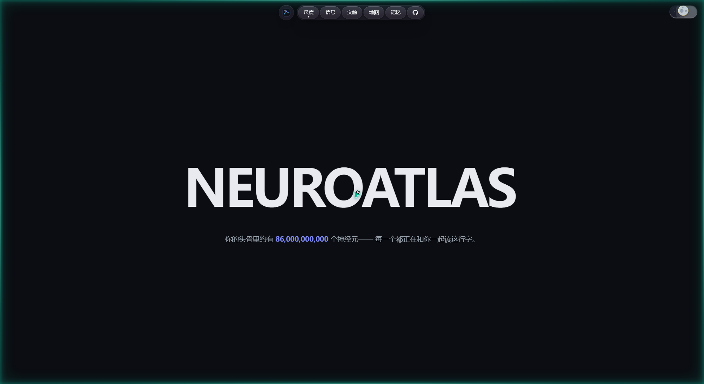

# NEUROATLAS · 神经图谱

一份用可交互可视化讲解神经信号基础知识的**课程教学演示网站**。

**在线访问：<https://haomiaoyan.github.io/NEUROATLAS/>**（push 到 `main` 自动部署）



> 你的头骨里约有 86,000,000,000 个神经元——每一个都正在和你一起读这行字。

## 它是什么 / 不是什么

- **是**：前端课程作品，用滚动叙事 + 可视化讲解「一颗粒子如何在脑中以 120 m/s 奔跑」；附带一个可运行的 Hodgkin-Huxley 数值求解器，供课程论文做数值实验。
- **不是**：医疗建议，也不是真实临床数据的复现；每个数字旁都标了文献出处或「教学示意」，统一由 `src/data/sources.ts` 注册表校验。

## 内容结构

页面按下方顺序编排（见 `src/App.tsx`）：

| 区块 | 内容 |
|---|---|
| Hero | 数字冲击开场（TechText 标题 + SwarmCursor 粒子群 + CountUp 数字滚动） |
| 尺度总览 | 从纳米到厘米的生物尺度轴，放在折叠线下方 |
| CHAPTER 01 · 信号长舞台 | 动作电位：静息 −70 mV → 阈值 −55 mV → 峰值 +30 mV → 120 m/s（ScrollTrigger pin + scrub） |
| CHAPTER 02 · 突触 | 电信号 ↔ 化学信号的换乘站，7,000 个连接点 |
| CHAPTER 03 · 大脑地图 | 皮层分区、160 亿神经元与 20% 的能量账单 |
| CHAPTER 04 · 记忆 | 短期记忆 → 海马体转写 → 长期记忆（H.M. 案例） |
| 章节索引 | 漏掉时跳转，兼作正文对比度验收锚点；附 Okabe-Ito 色板示例 |
| 文末小测 | 读完全章后的互动测验 |
| Outro / SpikeLab | 收尾区，内嵌「动作电位发射器」互动模块与「真实模型」HH 折叠面板 |

## 运行

```bash
npm install
npm run dev          # 开发（localhost:5173）
npm run build        # 类型检查 + 构建
npm run preview      # 预览构建产物（0.0.0.0）
npm test             # vitest：14 个测试（主题 4 / 出处校验 3 / HH 求解器 7）
npm run verify       # 浏览器级脚本化验收（当前 69 条，双主题各跑）
npm run experiment   # HH 数值实验 E1–E5，输出 CSV
```

`npm run verify` 覆盖对比度、溢出、pin、滚动距离、帧率与首屏数字等，结果写到 `.tmp/verify-report.json`；`npm test` 不拦类型错误，**验收以 `npm run build` 为准**。

## 计算模块：Hodgkin-Huxley 求解器

`src/lib/hh.ts` 实现经典 Hodgkin-Huxley 四维方程（V/m/h/n）的数值求解，采用 1952 年乌贼巨大轴突参数集，电压用现代教材的偏移约定（静息约 −65 mV）。模块是纯计算，不依赖 React 或 DOM，浏览器与 Node 都能直接调用。

- **积分器**：RK4（默认，精度高）与 Euler（便于对比步长误差），`dt`、`duration`、注入电流 `I(t)`、初始状态与参数集均可配置。
- **返回**：`t / V / m / h / n` 时间序列，以及检测到的 `spikes` 列表（含首次 spike 时间）。
- **单测**：`tests/hh.test.ts` 共 7 个，校验静息态、阈值触发、spike 检测、两种积分器一致性与参数边界。
- **页面集成**：`SpikeLab` 中默认收起的「真实模型」面板调用该模块；页面默认呈现的手绘示意曲线保持不变，两者互不干扰。
- **批量实验**：`npm run experiment` 运行 `scripts/hh-experiments.mjs` 的 E1–E5（步长收敛性、阈值、电流–频率关系等），数据由 `simulate()` 实跑产出、不手写，CSV 输出到 `../coursework-2026fall/data/`。

```ts
import { simulate } from './src/lib/hh.ts'

const r = simulate({
  dt: 0.01,
  duration: 50,
  stimulus: (t) => (t < 20 ? 10 : 0), // 0–20 ms 注入 10 µA/cm²
  integrator: 'rk4',
})
console.log(r.spikes.length, Math.max(...r.V)) // 发射次数与峰值 mV
```

## 技术栈与工程约定

- React 18 + Vite 5 + TypeScript（strict）；动效为 gsap 3.15.1（ScrollTrigger 长舞台 pin + scrub）。
- TechText / SwarmCursor 为 React Bits 源码集成（含三处适配改动），非运行时依赖。
- 主题优先级：本地存储 `neuroatlas-theme` → 系统 `prefers-color-scheme` → 浅色；页头一键切换。数据编码色用 Okabe-Ito 色盲友好色板，且不随主题变化。
- 无障碍：所有可视化 `role="img"` + `aria-label`；`prefers-reduced-motion` 下动效全停、信息不减。
- 每个页面数字必须在 `src/data/sources.ts` 注册并带 `source` 字段（`kind` 为 `literature` 或 `illustrative`），由 vitest 强制校验；页面运行时也断言所有 `data-fact` 的 id 都在注册表内。
- 验收以 `npm run build` 为准，`scripts/verify.mjs` 为浏览器级断言（需 Chrome / Edge）；`scripts/check-hh-panel.mjs` 单独检查 HH 面板 DOM。
- 开发按批次推进（b0–b5 脚手架、Hero、导航组件、长舞台、内容章节、收尾，随后 B7–B11 交互增强与 HH 计算模块），每步可独立回滚；设计素材在 `docs/`。

## License 与引用

MIT —— 详见 [LICENSE](./LICENSE)。若在教学或研究中使用本项目，请按 [CITATION.cff](./CITATION.cff) 引用。
